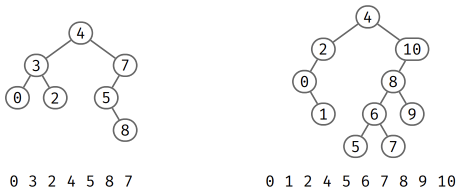
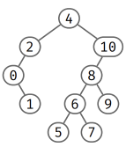
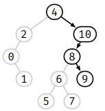
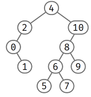
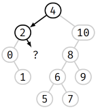
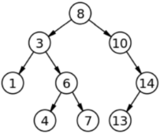
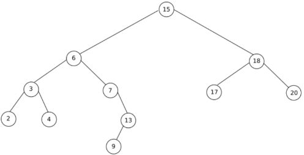
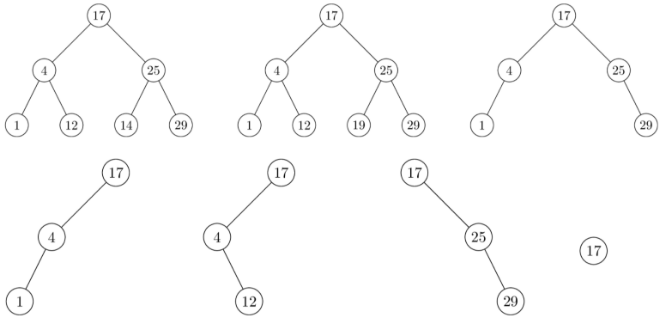
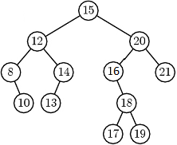

---

## 🗂️ **Table des matières**

1. 🔰 [Introduction](#_toc149153662)
2. 🧾 [Définition](#_toc149153663)
3. ⚡ [Est-ce performant ?](#_toc149153664)
4. 🧩 [Exemples](#_toc149153665)
5. 🛠️ [Les algorithmes et les implémentations en Python](#_toc149153666)
6. 📝 [Exercices](#_toc149153671)
7. 🚀 [Projet](#_toc149153672)

---

## 🎯 **Compétences évaluables**

* Rechercher une clé dans un arbre de recherche
* Insérer une clé

---

## <H2 STYLE="COLOR:BLUE;">1. 🔰 Introduction</H2>

Le **parcours infixe** des arbres ci-dessous :

{: .center }

* Le **premier arbre** donne des valeurs *non ordonnées*
* Le **second arbre** donne des valeurs *ordonnées*

➡️ Disposer de **valeurs ordonnées** permet d’avoir des **algorithmes plus performants.**

C’est ce type d’arbre que l’on appelle un **arbre binaire de recherche (ABR)**.

---

## <H2 STYLE="COLOR:BLUE;">2.🧾  Définition</H2>

Un **arbre binaire de recherche (ABR)** (*Binary Search Tree*, BST) est une structure hiérarchique composée de **nœuds**.
Chaque nœud possède au maximum **deux enfants**, ordonnés selon cette règle :

* Toutes les valeurs du **sous-arbre gauche** sont **inférieures** à celle du nœud.
* Toutes les valeurs du **sous-arbre droit** sont **supérieures** à celle du nœud.
* Cette propriété est vraie pour **tous les nœuds** de l’arbre.

🌱 Le premier élément inséré devient **la racine**.
On place ensuite les **valeurs plus petites à gauche**, et les **plus grandes à droite.**


## <H2 STYLE="COLOR:BLUE;">3. ⚡ Est-ce performant ?</H2>

Un ABR permet des recherches **rapides**.
Prenons l’exemple suivant :
Rechercher la clé `9` 👇

 

✅ Clé trouvée !

Rechercher la clé `3` 👇

 

❌ La clé `3` **n’est pas présente** dans l’ABR.

> 🔎 Grâce à la structure ordonnée, la recherche s’apparente à une **recherche dichotomique** :
> on divise l’espace de recherche à chaque étape.

⏱️ Rechercher ou insérer une clé, c’est descendre **une seule branche** : le coût est proportionnel à la **hauteur** de l’arbre.
Il vaut **O(log n)** si l’arbre est **équilibré**, ce qui est **bien plus performant** qu’un parcours linéaire d’une liste ; mais il vaut **O(n)** si l’arbre est **filiforme** (par exemple quand on insère des clés déjà triées).


##  <H2 STYLE="COLOR:BLUE;">4. 🧩 Exemples</H2>

**Exemple :**
La séquence `{8, 3, 10, 1, 6, 14, 4, 7, 13}` donne l’arbre suivant :

{: .center }

!!! info "🧠 Capytale => le code vous sera donné par votre enseignant"

???+ question "🌳 **Activité n° 1 : Séquence d’un ABR**"

    Quelle est la **séquence associée** à l’arbre binaire de recherche ci-dessous ?

    {: .center }

    ??? success "❇️ Solution :"

        L’arbre correspond à une séquence ordonnée de **gauche à droite**.  
        Il faut donc lire les valeurs selon le **parcours infixe (gauche → racine → droite)**.  
        👉 {2, 3, 4, 6, 7, 9, 13, 15, 17, 18, 20}


???+ question "🧠 **Activité n° 2 : Reconnaître un ABR**"

    Identifier lequel des arbres suivants respecte les **règles d’un arbre binaire de recherche**.

    {: .center }

    ??? success "❇️ Solution :"

        👉 Le **1er arbre n’est pas un ABR** : la clé 14 est dans le sous-arbre **droit** de la racine 17, alors que 14 < 17.  
        Les six autres arbres sont des ABR.


???+ question "🐾 **Activité n° 3 : Construire un ABR — Cas vétérinaire**"

    Un vétérinaire souhaite stocker les fiches médicales de ses animaux sous forme d’un ABR.  
    La clé de tri utilisée est **le nom de l’animal**, dans l’ordre **alphabétique croissant**.

    Il reçoit les animaux dans cet ordre :  
    **Gaufrette**, **Charlie**, **Médor**, **Flipper**, **Bubulle**, **Augustin**.

    Construire l’arbre correspondant.

    ??? success "❇️ Solution :"

        - Racine : Gaufrette  
        - Charlie < Gaufrette → gauche  
        - Médor > Gaufrette → droite  
        - Flipper < Gaufrette mais > Charlie → droite de Charlie  
        - Bubulle < Charlie → gauche de Charlie  
        - Augustin < Bubulle → gauche de Bubulle  


???+ question "🔁 **Activité n° 4 : Impact de l’ordre d’insertion**"

    Reprenons la séquence :  
    `{Gaufrette, Charlie, Médor, Flipper, Augustin, Bubulle}`  
    ➤ Augustin arrive **avant** Bubulle.

    L’arbre obtenu est-il le même ?  
    Quelle **conclusion** peut-on en tirer ?

    ??? success "❇️ Solution :"

        Non, l’arbre est **différent** car **l’ordre d’insertion** influence sa forme.  
        Un ABR **ne dépend pas uniquement des valeurs**, mais aussi de **l’ordre d’ajout**.

        📌 À retenir :
        - La **valeur la plus à gauche** → le **minimum**  
        - La **valeur la plus à droite** → le **maximum**


##  <H2 STYLE="COLOR:BLUE;">5. 🛠️ Les algorithmes et les implémentations en Python</H2>


###  <H3 STYLE="COLOR:GREEN;">5.1. 🧱 Créer un ABR</H3>

Un ABR est composé de **nœuds**.
Chaque nœud contient :

* une **valeur**,
* un **parent** (facultatif),
* deux **enfants** (gauche et droite).


???+ question "💻 **Activité n° 5 : Création d’un ABR en Python**"

    Implémenter la classe suivante :

    ```python
    class Node:
        def __init__(self, value, left=None, right=None):
            pass

        def __str__(self):
            pass

        def estFeuille(self):
            pass
    ```

    Puis tester avec le code suivant :

    ```python
    if __name__ == "__main__":
        n3 = Node(3)
        n7 = Node(7)
        n5 = Node(5, n3, n7)

        print(n5)
        print(n3.estFeuille())
        print(n5.estFeuille())
    ```

    ??? success "❇️ Solution :"

        ```python
        class Node:
            def __init__(self, value, left=None, right=None):
                self.value = value
                self.left = left
                self.right = right

            def __str__(self):
                return f"({self.value}, {self.left}, {self.right})"

            def estFeuille(self):
                return self.left is None and self.right is None
        ```


### <H3 STYLE="COLOR:GREEN;">5.2. ❤️ Insérer dans un ABR</H3>


📘 **Principe de l’algorithme d’insertion :**

1. Si l’arbre est **vide**, on crée la **racine**.
2. Sinon, on compare la **clé** au nœud courant :

   * Si elle est **inférieure**, on insère dans le **sous-arbre gauche**.
   * Si elle est **supérieure**, dans le **sous-arbre droit**.
3. L’insertion se fait **récursivement** jusqu’à trouver la bonne position.


???+ question "🌳 **Activité n° 6 : Insertion dans un ABR (fonction)**"

    Créer la **fonction** `inserer(T, data)` qui applique l’algorithme ci-dessus.

    On testera avec :
    ```python
    T = None 

    for value in [8, 3, 10, 1, 6, 14, 4, 7, 13]:
        T = inserer(T, value)

    print(T)
    ```

    ??? success "❇️ Solution :"

        ```python
        class Node:
            def __init__(self, value, left=None, right=None):
                self.value = value
                self.left = left
                self.right = right

            def __str__(self):
                return f"({self.value}, {self.left}, {self.right})"

        def inserer(T, data):
            if T is None:
                return Node(data)
            if data < T.value:
                T.left = inserer(T.left, data)
            elif data > T.value:
                T.right = inserer(T.right, data)
            return T
        ```


???+ question "🌿 **Activité n° 7 : Insertion dans un ABR (méthode)**"

    Créer la **méthode** `insert(self, data)` dans la classe `Node`.

    On testera avec :
    ```python
    T = Node(8)  

    for value in [3, 10, 1, 6, 14, 4, 7, 13]:
        T.insert(value)

    print(T)
    ```

    ??? success "❇️ Solution :"

        ```python
        class Node:
            def __init__(self, value, left=None, right=None):
                self.value = value
                self.left = left
                self.right = right

            def insert(self, data):
                if data < self.value:
                    if self.left is None:
                        self.left = Node(data)
                    else:
                        self.left.insert(data)
                elif data > self.value:
                    if self.right is None:
                        self.right = Node(data)
                    else:
                        self.right.insert(data)
        ```

        ✅ Les deux approches (`inserer()` et `insert()`) sont **équivalentes** :  
        elles construisent toutes deux un ABR à partir d’une série de valeurs.


On peut représenter visuellement un ABR avec la bibliothèque **Graphviz**, qui permet d’afficher les nœuds et les liens parent-enfant.


???+ question "🌿 **Activité n° 8 : Représentation graphique de l’arbre (fonction)**"

    Implémenter la fonction suivante pour afficher un arbre :

    ```python
    from graphviz import Digraph

    def dessiner_arbre_graphviz(arbre):
        """
        Génère un rendu visuel de l'ABR en utilisant Graphviz.
        """
        def ajouter_noeud(graphe, arbre):
            if arbre:
                graphe.node(str(arbre.value))
                if arbre.left:
                    graphe.edge(str(arbre.value), str(arbre.left.value))
                    ajouter_noeud(graphe, arbre.left)
                if arbre.right:
                    graphe.edge(str(arbre.value), str(arbre.right.value))
                    ajouter_noeud(graphe, arbre.right)

        dot = Digraph(comment="Arbre Binaire de Recherche")
        ajouter_noeud(dot, arbre)
        return dot

    dot = dessiner_arbre_graphviz(T)
    dot
    ```

    ??? success "❇️ Solution :"

        💡 La fonction crée un **graphe orienté** où :
        - chaque **nœud** correspond à une valeur de l’arbre,  
        - et chaque **lien** représente la relation parent → enfant.


???+ question "🌳 **Activité n° 9 : Tester la représentation graphique**"

    Tester le programme précédent avec les deux approches : **méthode** et **fonction**.

    **Avec la méthode :**
    ```python
    abr = Node(6)
    abr.insert(8)
    abr.insert(3)
    abr.insert(1)
    abr.insert(4)
    abr.insert(9)
    abr.insert(2)
    abr.insert(7)
    abr.insert(5)
    dot_abr = dessiner_arbre_graphviz(abr)
    dot_abr
    ```

    **Puis avec la fonction :**
    ```python
    T = Node(6)
    inserer(T, 8)
    inserer(T, 3)
    inserer(T, 1)
    inserer(T, 4)
    inserer(T, 9)
    inserer(T, 2)
    inserer(T, 7)
    inserer(T, 5)
    dot_T = dessiner_arbre_graphviz(T)
    dot_T
    ```

    ??? success "❇️ Solution :"

        Les deux approches produisent le **même arbre visuel**.  
        On peut éviter la répétition en insérant les valeurs avec une **boucle sur liste** :
        ```python
        T = Node(6)
        for v in [8, 3, 1, 4, 9, 2, 7, 5]:
            inserer(T, v)
        ```


###  <H3 STYLE="COLOR:GREEN;">5.3. 🔍 ❤️ Recherche d’une clé dans un ABR ❤️</H3>

Pour **rechercher une clé donnée**, on applique la même logique que pour l’insertion :

1. Si la clé est égale à la valeur du nœud courant → **clé trouvée**.
2. Si elle est **supérieure**, on cherche dans le **sous-arbre droit**.
3. Sinon, on cherche dans le **sous-arbre gauche**.


???+ question "🧠 **Activité n° 10 : Recherche dans un ABR (fonction)**"

    Créer une **fonction** `rechercher(T, cle)` selon l’algorithme ci-dessus.  

    Tester avec la clé `7` puis `188`.

    ??? success "❇️ Solution :"

        ```python
        def rechercher(T, cle):
            if T is None:
                return False
            if cle == T.value:
                return True
            elif cle < T.value:
                return rechercher(T.left, cle)
            else:
                return rechercher(T.right, cle)
        ```

        ✅ Recherche  :  
        - 7 → trouvée  
        - 188 → non trouvée


???+ question "🌿 **Activité n° 11 : Recherche dans un ABR (méthode)**"

    Ajouter une **méthode** `search()` à la classe `Node`.

    Tester-la avec les valeurs `7` et `188`.

    ??? success "❇️ Solution :"

        ```python
        class Node:
            ...
            def search(self, cle):
                if self.value == cle:
                    return True
                elif cle < self.value and self.left:
                    return self.left.search(cle)
                elif cle > self.value and self.right:
                    return self.right.search(cle)
                else:
                    return False
        ```

        👉 Les résultats sont identiques à ceux de la fonction `rechercher()`.


### <H3 STYLE="COLOR:GREEN;">5.4. 🌿  Parcours infixe</H3>

Le **parcours infixe** consiste à :

1. parcourir le **sous-arbre gauche**,
2. **afficher la racine**,
3. puis parcourir le **sous-arbre droit**.

Il permet d’obtenir les valeurs **dans l’ordre croissant**.


???+ question "🌳 **Activité n° 12 : Parcours infixe**"


    Créer une **fonction** `parcours_infixe(T)` qui affiche les valeurs de l’arbre dans l’ordre croissant.  

    Tester-la sur les deux arbres précédents. Que remarquez-vous ?

    ??? success "❇️ Solution :"

        ```python
        def parcours_infixe(T):
            if T:
                parcours_infixe(T.left)
                print(T.value, end=" ")
                parcours_infixe(T.right)
        ```

        ✅ Le parcours infixe affiche toujours les **valeurs triées** d’un ABR.


## <H2 STYLE="COLOR:BLUE;"> <a name="_toc149153671"></a>**6. 🔍 Exercices**</H2>

!!! example "🧠 Exercices dans Capytale => le code vous sera donné par votre enseignant"

!!! abstract "**Exercice n° 01 : Implémentation de quelques méthodes dans un ABR**"

    Utiliser la classe Node du cours pour implémenter les méthodes suivantes.


    1. Recopier  le fichier ABR
    2. D’après les propriétés de l’arbre, le nœud ayant la plus petite valeur se trouve forcément le plus à gauche. Implémenter une méthode qui donnera le min de l’ABR
    3. Pour rechercher le maximum, c’est la logique inverse de la recherche du minimum, on descend le plus à droite possible. Implémenter une méthode qui donnera le maximum de l’ABR
    4. Implémenter la méthode ou la fonction donnant la hauteur de l’ABR (convention 1 pour la racine)
    5. Implémenter la méthode ou la fonction donnant le parcours en largeur de l’ABR
    6. Implémenter la méthode ou la fonction donnant la taille de l’ABR

!!! abstract "**Exercice n° 02 : Trier une liste en utilisant un ABR**"

    1. Créer une liste de 10 entiers aléatoires distincts, puis générer un ABR dont les clés sont ces entiers. 
    2. Utiliser la fonction `dessiner_arbre_graphviz` (activité 8) pour l’afficher. 
    3. Quel parcours permet d’afficher ces nombres dans l’ordre croissant ? 
    4. Écrire une fonction `infixe(abr, lst_triee)` prenant en argument un ABR et une liste vide, et ajoutant les clés de l’ABR à la liste dans l’ordre. 
    5. Écrire la fonction tri\_abr(lst) renvoyant une copie triée de la liste lst en utilisant un ABR.

## <H2 STYLE="COLOR:BLUE;"> <a name="_toc149153672"></a>**7. 🌿 Projet**</H2>

!!! example "🧠 Exercices dans Capytale => le code vous sera donné par votre enseignant"

!!! abstract "**Exercice n° 01 : arbre binaire de recherche ABR**"


    

    **Insertion**

    L'insertion d'un nœud commence par une recherche : on cherche la clé du nœud à insérer ; lorsqu'on arrive à une feuille, on ajoute le nœud comme fils de la feuille en comparant sa clé à celle de la feuille : si elle est inférieure, le nouveau nœud sera à gauche ; sinon il sera à droite.

    On choisit d’implémenter de tels arbres binaires à l’aide de la classe suivante, où on utilise des valeurs par défaut dans le constructeur pour les deux enfants :

    ```python
    class BinarySearchTree:
        def __init__(self, key : int, left_child=None, right_child=None):
            self.__key   = int(key)
            self.__left  = left_child	# None ou un arbre de la classe BinarySearchTree
            self.__right = right_child	# None ou un arbre de la classe BinarySearchTree
    ```


    1 Implémenter une méthode \_\_repr\_\_()

    ```python
    def is_leaf(self):
        """ fonction testant si l'arbre est une feuille"""
        return not self.__left and not self.__right

    def __repr__(self):
        if self.is_leaf():
            return "<" + str(self.__key) + ">"
        left  = "<>" if self.__left is None else self.__left.__repr__()
        right = "<>" if self.__right is None else self.__right.__repr__()
        return "<{0},{1},{2}>".format(self.__key, left, right)
    ```

    2 Ajouter une méthode publique insert() qui ajoute un nœud à l’arbre.

    3 Créer un ABR correspondant au schéma ci-dessus.

    4 Valider le test unitaire suivant :

    ```python
    str(abr) == "<15,<12,<8,<>,<10>>,<14,<13>,<>>>,<20,<16,<>,<18,<17>,<19>>>,<21>>>"
    ```

    5 Implémenter une méthode publique infix\_traversal() de parcours en profondeur infixé de l’arbre.

    6 Valider le test unitaire suivant :

    ```python
    abr.infix_traversal() == [8, 10, 12, 13, 14, 15, 16, 17, 18, 19, 20, 21]
    ```

    7 Insérer à nouveau la clé 15 et relancer les tests précédents : que se passe-t-il ? Modifier `insert` pour qu’une clé **déjà présente** ne soit pas ajoutée une seconde fois, puis revalider les tests.

    **Recherche**

    La recherche dans un ABR d'un nœud ayant une clé particulière est un procédé récursif. On commence par examiner la racine. Si sa clé est la clé recherchée, l'algorithme se termine et renvoie la racine. Si elle est strictement inférieure, alors elle est dans le sous-arbre gauche, sur lequel on effectue alors récursivement la recherche. De même si la clé recherchée est strictement supérieure à la clé de la racine, la recherche continue dans le sous-arbre droit. Si on atteint une feuille dont la clé n'est pas celle recherchée, on sait alors que la clé recherchée n'appartient à aucun nœud.

    8 Ajouter une méthode publique `search()` qui recherche une clé dans l’arbre et retourne True si la clé est trouvée, False sinon.

    9 Valider les tests unitaires suivants :

    ```python
    abr.search(16) == True
    abr.search(9) == False
    ```

    On peut comparer l'exploration d'un ABR avec la recherche par dichotomie qui procède à peu près de la même manière, sauf qu'elle accède directement à chaque élément d'un tableau au lieu de suivre des liens. La différence : la dichotomie coupe **toujours** l'intervalle en deux moitiés (coût O(log n) garanti), alors que dans un ABR le découpage dépend de la **forme** de l'arbre (O(log n) s'il est équilibré, O(n) s'il est filiforme).

!!! abstract "**Exercice n° 02 : arbre binaire de recherche des Pokémon**"

    Le fichier `pokemon.csv` (800 Pokémon) et les fonctions d'interface de l'ABR sont fournis dans l'activité Capytale.

    

    **Les fonctions d'interface**

    | Fonction | Rôle |
    |---|---|
    | `nvND(cle, data)` | crée un **nœud** de clé `cle`, avec les données `data` |
    | `cle(noeud)`, `data(noeud)` | renvoient la clé et les données d'un nœud |
    | `nvAV()` | crée un **arbre vide** |
    | `nvABR(racine, g, d)` | crée un arbre de racine `racine` et de sous-arbres `g` et `d` |
    | `estArbreVide(arbre)` | `True` si l'arbre est vide |
    | `racine(arbre)`, `gauche(arbre)`, `droite(arbre)` | la racine (un nœud) et les sous-arbres (des arbres) |
    | `inserer_noeud_dans_ABR(arbre, nd)` | insère le nœud : à **gauche** si sa clé est plus petite, à **droite** sinon |

    **Partie 1 — Les enregistrements**

    La variable `pokemons` est un tableau de dictionnaires, un par Pokémon, de clés `name`, `hp`, `attack`, `defense`, `happiness` et `is_legendary`.

    1. Comment obtenir l'enregistrement d'indice 0 de `pokemons` ?
    2. Comment afficher, une par une, les clés de cet enregistrement ?
    3. Comment afficher, un par un, les couples (clé, valeur) sous la forme « La clé c est associée à la valeur v » ?
    4. Comment obtenir l'attaque du Pokémon d'indice 0, puis sous forme d'entier ?

    **Partie 2 — Construire un ABR**

    5. Lire la documentation des fonctions `inserer_noeud_dans_ABR`, `nvABR` et `nvND` avec `help`. Certains paramètres ont-ils une valeur par défaut ?
    6. Dessiner sur papier l'arbre construit par la fonction suivante, puis vérifier en l'affichant :

        ```python
        def creation_test():
            arbre = nvABR(nvND(20))
            inserer_noeud_dans_ABR(arbre, nvND(25))
            inserer_noeud_dans_ABR(arbre, nvND(15))
            inserer_noeud_dans_ABR(arbre, nvND(17))
            inserer_noeud_dans_ABR(arbre, nvND(10))
            return arbre
        ```

    7. Insérer un nœud de clé 21. Où se place-t-il ?

    **Partie 3 — L'arbre à Pokémon**

    8. La fonction `creation_aap` construit un ABR avec les 41 premiers Pokémon, rangés selon leur **attaque**. Quel attribut joue le rôle de clé ? Que contiennent `d` et `c` à chaque tour de boucle ? Quelle est la taille de l'arbre obtenu ?
    9. Comparer deux façons d'interroger l'arbre : `cle(racine(aap))` et `aap.racine.cle`. Laquelle n'utilise que l'interface ? Laquelle faut-il privilégier si l'implémentation change ?

    **Partie 4 — Recherche**

    10. Écrire la fonction `recherche(arbre, c)` qui renvoie le nœud de clé `c` (ou `None`), en n'utilisant que les fonctions d'interface. Par exemple, `data(recherche(aap, 102))['name']` vaut `'Nidoking'`.

    **Partie 5 — Affichages particuliers**

    11. Écrire `parcours_infixe(arbre)` qui affiche les attaques des 41 Pokémon dans l'ordre croissant (de 20 à 150).
    12. Écrire `parcours_infixe2(arbre)` qui affiche aussi le nom : `20 pour Metapod`, `25 pour Kakuna`… `150 pour BeedrillMega Beedrill`.
    13. À droite toute : la fonction récursive `cle_max` renvoie la plus grande clé (150). Écrire de même `cle_min` (à gauche toute), qui renvoie 20.
